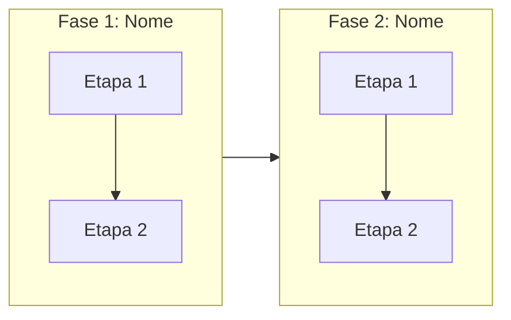

# Visão: [Nome do Projeto/Produto]

> **Status:** [Em Descoberta / Em Validação / Aprovado] 
> **Última atualização:** [YYYY-MM-DD] 
> **Versão:** 1.0

---

## 1. Contexto do Cliente

### 1.1 Cliente Direto

A equipe ou organização atendida diretamente pelo projeto, ou seja, nosso cliente.

| Aspecto | Informação |
|--------|-------------|
| **Empresa/Equipe** | [Nome da empresa, organização ou equipe que contratou ou solicitou o projeto] |
| **Domínio** | [Por exemplo: fintech, comércio eletrônico, saúde, logística ou governo] |
| **Tamanho da equipe** | [Pequena: menos de 10 desenvolvedores / Média: 10 a 50 desenvolvedores / Grande: mais de 50 desenvolvedores] |
| **Canais** | [Web, dispositivos móveis, API etc.] |

### 1.2 Cliente Final

O usuário ou consumidor atendido pelo cliente direto.

| Aspecto | Informação |
|--------|-------------|
| **Perfil** | [Quem são os usuários finais do produto ou serviço] |
| **Volume** | [Quantidade de usuários, transações ou outra métrica relevante] |
| **Contexto de uso** | [Como e onde o cliente final interage com o produto] |

### 1.3 Contexto Adicional

[Descreva os produtos ou sistemas existentes que serão consolidados ou substituídos, se aplicável]

---

## 2. Foco do Projeto

### Problema Priorizado

[Descreva o principal problema que este projeto resolve]

| Aspecto | Decisão |
|--------|----------|
| **Foco escolhido** | [O que será resolvido] |
| **Justificativa** | [Por que este foco foi escolhido] |
| **Escopo inicial** | [O que está incluído] |
| **Fora do escopo inicial** | [O que foi excluído e por quê] |

---

## 3. Usuários-Alvo

### 3.1 [Nome do Perfil de Usuário 1]

[Descrição do perfil]

**Necessidades principais:**
- [Necessidade 1]
- [Necessidade 2]
- [Necessidade 3]

### 3.2 [Nome do Perfil de Usuário 2] (se aplicável)

[Descrição do perfil]

**Necessidades principais:**
- [Necessidade 1]
- [Necessidade 2]

---

## 4. Diagnóstico: Problemas Conhecidos

### 4.1 Problemas de Negócio

| Problema | Impacto | Fonte |
|---------|--------|--------|
| [Problema 1] | [Custo, perda de receita, cancelamento de clientes etc.] | [Origem dos dados] |
| [Problema 2] | [Impacto mensurável] | [Origem dos dados] |
| [Problema 3] | [Impacto mensurável] | [Origem dos dados] |

**Principal área de impacto:**
- [ ] Experiência do usuário final
- [ ] Operações internas
- [ ] Custos e eficiência
- [ ] Crescimento e escalabilidade
- [ ] Várias áreas

### 4.2 Problemas Técnicos

Categorias: Fragmentação, Escalabilidade, Segurança, Observabilidade, Agilidade, Integração, Desempenho, Manutenibilidade

| Categoria | Problema | Impacto |
|----------|---------|--------|
| [Categoria] | [Descrição] | [Impacto no sistema ou negócio] |
| [Categoria] | [Descrição] | [Impacto no sistema ou negócio] |
| [Categoria] | [Descrição] | [Impacto no sistema ou negócio] |

---

## 5. Jornada do Usuário

[Mapeamento das principais etapas da jornada]

