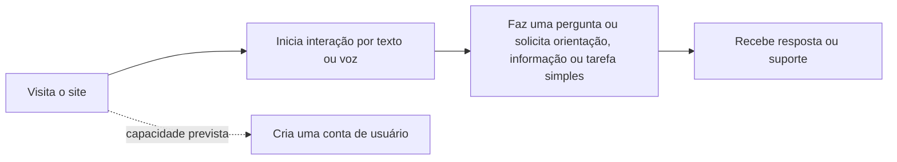

# Visão: Agente Conversacional

> **Status:** Em descoberta 
> **Última atualização:** 2026-11-19 
> **Versão:** 1.0

---

## 1. Contexto do Cliente

### 1.1 Cliente Direto

O produto está sendo criado por seu idealizador e poderá ser adaptado e licenciado a empresas de diferentes setores.

| Aspecto | Informação |
|--------|-------------|
| **Empresa/Equipe** | Produto próprio; empresa ou equipe responsável ainda não informada |
| **Domínio** | Atendimento digital, automação de suporte e interações inteligentes em sites corporativos |
| **Tamanho da equipe** | Não informado |
| **Canais** | Sites; interação com o agente por texto e voz |

### 1.2 Cliente Final

| Aspecto | Informação |
|--------|-------------|
| **Perfil** | Visitantes dos sites que usam o agente para obter suporte |
| **Volume** | Não informado |
| **Contexto de uso** | Fazer perguntas, receber informações, navegar pelo site, realizar tarefas simples e obter suporte conversacional |

### 1.3 Contexto Adicional

Na primeira versão, o agente complementará os canais de atendimento e suporte existentes. Integrações com CRM, bases de conhecimento, plataformas de atendimento e ferramentas de automação são possibilidades futuras, sem compromisso para a versão inicial.

---

## 2. Foco do Projeto

### Problema Priorizado

A lentidão nas respostas é o problema conhecido a ser priorizado. O resultado desejado é reduzir o tempo de resposta; ainda não foi fornecida uma medida de impacto atual.

| Aspecto | Decisão |
|--------|----------|
| **Foco escolhido** | Reduzir o tempo de resposta do suporte conversacional |
| **Justificativa** | A lentidão foi identificada como o problema atual |
| **Escopo inicial** | Agente conversacional por texto e voz, capaz de responder perguntas, orientar a navegação, fornecer informações, apoiar tarefas simples e oferecer suporte; incluir criação de conta de usuário |
| **Fora do escopo inicial** | Integrações com sistemas externos não estão comprometidas para a primeira versão; detalhes ainda não definidos |

---

## 3. Usuários-Alvo

### 3.1 Visitante do site

Pessoa que acessa um site atendido pelo agente e busca ajuda ou informações.

**Necessidades principais:**
- Obter respostas e orientação sem demora.
- Encontrar informações e navegar pelo site com ajuda conversacional.
- Realizar tarefas simples e poder criar uma conta de usuário.
- Interagir por texto ou voz.

---

## 4. Diagnóstico: Problemas Conhecidos

### 4.1 Problemas de Negócio

| Problema | Impacto | Fonte |
|---------|--------|--------|
| Lentidão nas respostas de suporte | Deseja-se reduzir o tempo de resposta; impacto quantitativo e baseline não informados | Contexto fornecido pelo idealizador |

**Principal área de impacto:**
- [x] Experiência do usuário final
- [ ] Operações internas
- [ ] Custos e eficiência
- [ ] Crescimento e escalabilidade
- [ ] Várias áreas

### 4.2 Problemas Técnicos

| Categoria | Problema | Impacto |
|----------|---------|--------|
| Desempenho | Foi relatada lentidão nas respostas; causa técnica ainda não identificada | Necessidade de reduzir o tempo de resposta; impacto mensurado não informado |

---

## 5. Jornada do Usuário

Visão inicial da interação; o fluxo e o momento da criação de conta ainda precisam ser validados.

---

## 6. Objetivos e Sucesso

**Objetivo de negócio:** reduzir o tempo de resposta no suporte digital oferecido aos visitantes dos sites.

**Objetivo técnico:** atender à meta de resposta abaixo de 3 segundos tanto para interações por texto quanto por voz. O ponto exato de início e fim da medição ainda precisa ser definido.

**Métrica informada:** tempo de resposta inferior a 3 segundos para texto e voz. Não foram fornecidos baseline nem outras métricas de sucesso.

---

## 7. Questões em Aberto

- Quais dados serão solicitados e qual será o fluxo para criar uma conta de usuário?
- Em que ponto da interação será medido o tempo de resposta, tanto para texto quanto para voz?
- Qual é o tempo de resposta atual (baseline) e quais outras métricas, se houver, serão usadas para avaliar o sucesso?
- Qual será o nome da empresa/equipe responsável e qual o porte do projeto?
